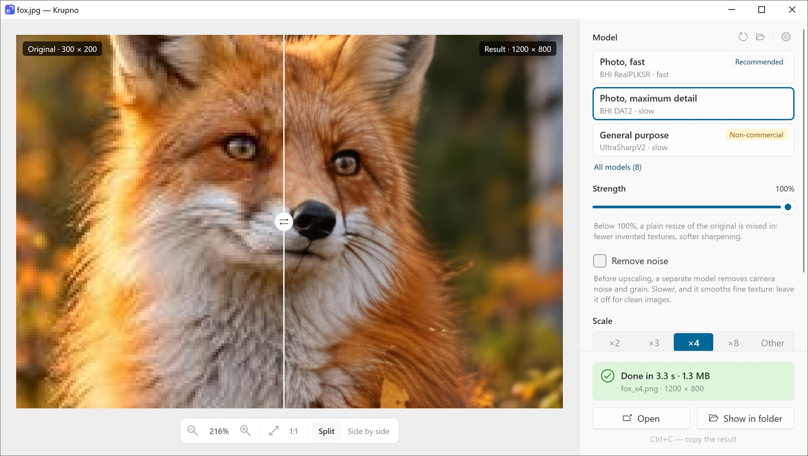
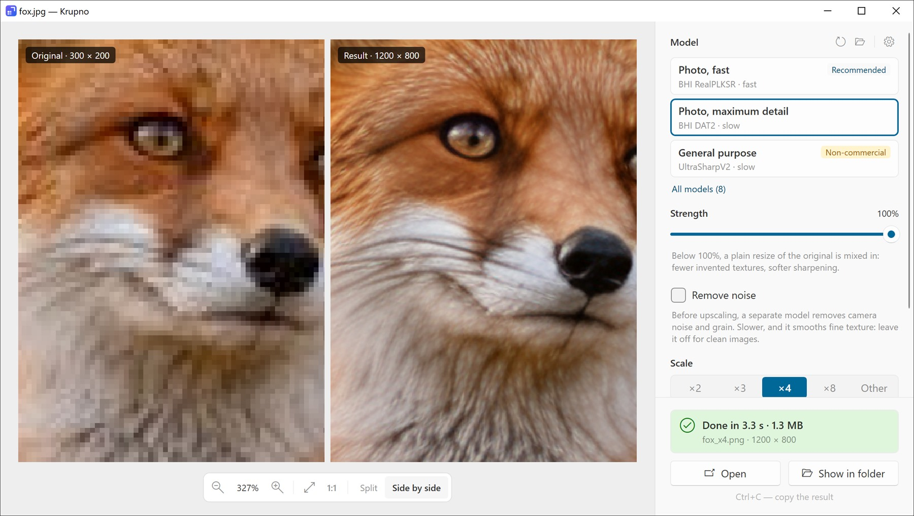

# Krupno

[](https://github.com/FLABER87/krupno/actions/workflows/tests.yml)

**Krupno** is an AI image upscaler for Windows. It enlarges photos and other images ×2, ×4 or to any size with neural networks, in a window (`Krupno.exe`) or from the command line (`krupno-cli.exe`).

<picture>
  <source media="(prefers-color-scheme: dark)" srcset="docs/images/split-dark.jpg">
  
</picture>

*A 300×200 photo (AI-generated) upscaled ×4 with "Photo, maximum detail": the original on the left of the slider, the result on the right.*

- Runs on any DirectX 12 GPU (NVIDIA, AMD or Intel, integrated ones included) and falls back to the CPU. On Windows 11 24H2 and later it can also use the GPU and NPU vendors' accelerators, such as NVIDIA TensorRT-RTX and Intel OpenVINO.
- Large images are processed in tiles that fit in video memory, without visible seams.
- Keeps transparency, EXIF rotation and color profiles. Reads PNG, JPEG, TIFF, BMP, GIF, WebP and HEIC; writes PNG, JPEG, TIFF and BMP.
- Upscales animated GIF and WebP frame by frame into an animation of the same format, with the same timing.
- Works offline: apart from an update check you can turn off, it sends nothing over the network.
- The window speaks 16 languages.
- Needs Windows 10 1903 or later, x64.

## Download and install

Get the latest version from [Releases](https://github.com/FLABER87/krupno/releases):

- **Installer** (`Krupno-<version>-setup-x64.exe`, recommended). By default it installs Krupno for the current user, to `%LOCALAPPDATA%\Programs\Krupno`, without administrator rights; "for all users" installs it to Program Files. .NET comes with it, so nothing else needs to be installed. During setup you pick the [models](#models) to download, and optionally:
  - a desktop shortcut;
  - the install folder in PATH, so `krupno-cli` runs from any console;
  - "Upscale with Krupno" in the Explorer context menu of images and folders.
- **Scoop**: `scoop bucket add krupno https://github.com/FLABER87/krupno`, then `scoop install krupno/krupno`. It installs the portable ZIP with the default model; `krupno-cli` is on the PATH, and the models you add to its `models` folder are kept on updates (`scoop update krupno`).
- **Portable ZIP** (`Krupno-<version>-win-x64.zip`): unpack it and run `Krupno.exe`. It comes without models: download them from the [models-v4](https://github.com/FLABER87/krupno/releases/tag/models-v4) release into its `models` folder or into `%LOCALAPPDATA%\Krupno\models`.

The files are not code-signed yet, so Windows SmartScreen may warn on the first launch ("More info" → "Run anyway"). Each release has a `SHA256SUMS.txt` to check the downloads against.
Uninstalling keeps your settings, logs and own models in `%LOCALAPPDATA%\Krupno`.

## Window

Drop images or a folder into the window, click "Select files", paste with Ctrl+V or use "Upscale with Krupno" in Explorer. Then pick a model, a scale and a format, and click "Upscale".

<picture>
  <source media="(prefers-color-scheme: dark)" srcset="docs/images/side-dark.jpg">
  
</picture>

- **Strength** (10–100%) blends the network's result with a plain resize, to tone down the textures a model invents and its oversharpening.
- **Remove noise** runs a separate model on the image before upscaling, to clean camera noise and grain that the upscaler would keep or turn into invented texture. It is slower and smooths fine texture as well, so it is off by default. With "Other" set to a scale of 1, it only removes the noise. It needs the SCUNet model, which the installer offers.
- **Scale:** ×2, ×4 and so on, or "Other" for a scale of your own or a width, height or long side in pixels.
- **Comparison:** a slider or two frames side by side; the mouse wheel zooms, a double click toggles "Fit to window" and 1:1.
- **A batch** is shown as a strip of thumbnails with each file's status.
- **Settings** (the gear button, or Ctrl+,): the device and tile size ("Auto" by default), "Seamless tiles", "Test-time augmentation", the language and the update check. Under "Results": what happens to a result that is already there from an earlier run (by default it is kept and the new one gets a number, `photo_x4 (2).png`; or it is replaced, or the image is skipped), and "Add the model to the file name" (`photo_x4_4xBHI_dat2_real.png`), so the results of different models don't replace each other. The version is at the bottom of the window.
- **If something fails,** "Copy error details" puts what a bug report needs on the clipboard. The window's logs are in `%LOCALAPPDATA%\Krupno\logs`.

| Keys | Action |
|---|---|
| Ctrl+O | open files |
| Ctrl+V | paste files or an image |
| Ctrl+Enter | upscale |
| Esc | cancel processing |
| Ctrl+0 / Ctrl+1 | fit to window / pixel for pixel |
| Ctrl+Plus / Ctrl+Minus | zoom in / zoom out |
| Ctrl+C | copy the result |
| Ctrl+, | settings |

## Command-line tool

```bash
krupno-cli photo.jpg                               # → photo_x4.png next to the source
krupno-cli photo.jpg -s 2 -f jpg -q 92             # ×2 result as JPEG
krupno-cli C:\photos -o C:\photos_x4               # a whole folder
krupno-cli C:\photos -r -o D:\x4 --skip-existing   # subfolders too; only the images without a result
krupno-cli photo.jpg -m 4xBHI_dat2_real_fp16 --name-model   # → photo_x4_4xBHI_dat2_real.png
krupno-cli photo.jpg --long-side 3840              # 3840 px on the longer side
krupno-cli photo.jpg --denoise                     # remove noise first, then ×4
krupno-cli photo.jpg --denoise -s 1                # only remove noise
krupno-cli cat.gif -s 2                            # → cat_x2.gif, every frame ×2
krupno-cli --list-models --list-devices
```

`krupno-cli --help` lists every option. A result never replaces a source image; one from an earlier run is replaced unless `--no-overwrite` (the new one gets a number) or `--skip-existing` is given. Without `-m`, the default model is used (marked with an asterisk in `--list-models`).

## Models

Krupno runs ONNX upscaling models. The installer downloads the ones you tick from the [models-v4](https://github.com/FLABER87/krupno/releases/tag/models-v4) release; the ZIP comes without them.

| Model | In the window | License | Time¹ |
|---|---|---|---|
| `4xBHI_realplksr_dysample_real` | Photo, fast (**default**) | CC BY 4.0 | 6.7 s |
| `4xBHI_dat2_real` (fp16 and fp32) | Photo, maximum detail | CC BY 4.0 | 33 s (fp16) |
| `4x-UltraSharpV2` | General purpose | CC BY-NC-SA 4.0, **non-commercial only** | 42 s |
| `4x_foolhardy_Remacri_fp16` | Text and documents | CC BY-NC-SA 4.0, **non-commercial only** | 5.8 s |
| `RealESRGAN_x4plus` (fp16 and fp32) | Classic | BSD-3-Clause | 4.6 s (fp16) |
| `realesr-general-x4v3` | Draft | BSD-3-Clause | 1.6 s |

¹ A 1920×1200 photo upscaled ×4 on an RTX 3080.

The installer also offers `scunet_color_real_psnr_fp16`, the model of "Remove noise" (`--denoise`): SCUNet, which removes noise at the original size before the upscaler runs, in about as much time again as the default model. It helps most with Remacri, which keeps noise as it is; see [Noise](docs/models.md#noise).

Models make small text sharp, but they may also change it, digits included. Remacri keeps small text best and is worse than the others on photos; see [Text](docs/models.md#text). Check important numbers against the original whatever the model.

**Each model has its own license**, which Krupno's MIT license does not cover:

- The BHI models are by Philip Hofmann ([Phhofm/models](https://github.com/Phhofm/models)), under [CC BY 4.0](https://creativecommons.org/licenses/by/4.0/): commercial use is allowed, with attribution.
- UltraSharpV2 is by [Kim2091](https://huggingface.co/Kim2091/UltraSharpV2) and Remacri by foolhardy ([OpenModelDB](https://openmodeldb.info/models/4x-Remacri)), both under [CC BY-NC-SA 4.0](https://creativecommons.org/licenses/by-nc-sa/4.0/): **non-commercial use only**. The window marks them as such.
- The Real-ESRGAN models are by Xintao Wang ([Real-ESRGAN](https://github.com/xinntao/Real-ESRGAN)), under the BSD 3-Clause license.
- SCUNet, the model of "Remove noise", is by Kai Zhang ([cszn/SCUNet](https://github.com/cszn/SCUNet)), under the Apache 2.0 license.

Other models work too: put `.onnx` files into `%LOCALAPPDATA%\Krupno\models` ("Open models folder" in the window). To convert PyTorch weights (`.pth`, `.safetensors`), use `tools/convert_to_onnx.py`; see [docs/models.md](docs/models.md) for how, where to get weights and how the models compare. Community models, for example from [OpenModelDB](https://openmodeldb.info/), each have their own license, and many are for non-commercial use only.

## Updates

At startup the window asks github.com which release of Krupno is the latest: one request that carries only the app's version. If there is a newer one, a line above the settings says so:

- in an installed copy, "Update" downloads the new installer, checks it against the release's `SHA256SUMS.txt` and installs it in the same mode (for you or for all users), keeping your models and choices;
- the portable ZIP links to the release page instead.

Nothing is downloaded until you click "Update". To turn the check off, clear "Check for updates" in "Settings".

## Building

Requires the .NET SDK 10.

```bash
dotnet build Krupno.slnx -c Release
dotnet test tests/Krupno.Core.Tests -c Release
```

More for contributors in [docs/](docs):

- [development.md](docs/development.md): layout, tests, CI and translations;
- [installer.md](docs/installer.md): the installer, the portable ZIP and releases;
- [models.md](docs/models.md): converting models to ONNX and how they compare;
- [how-it-works.md](docs/how-it-works.md): tiling, memory, accelerators, color and the finer points of the window and the command-line tool.

## License

The code is under the MIT license, see [LICENSE](LICENSE). It does not cover the models: each has its own license (see [Models](#models)). The components Krupno ships with and the models it can download are listed in [THIRD-PARTY-NOTICES.txt](THIRD-PARTY-NOTICES.txt).
